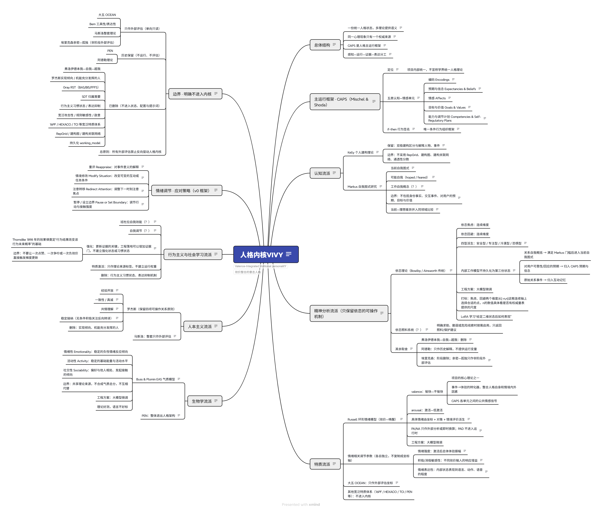
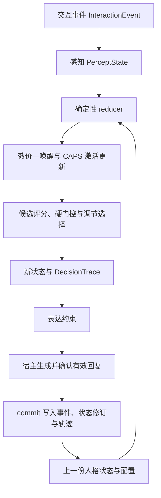

# VIVy_0_Open

**VIVy 研究的是：让 AI 的回应由可追踪的人格状态、情境理解与行为选择共同形成，并观察这种机制能否产生稳定而有情境差异的行为。**

VIVy 是 **Valence-Integrated Volitional personalitY（效价整合的意志人格）**：Valence 指效价—唤醒情绪内核，Integrated 指情绪与意图、调节决策的整合，Volitional 指意图选择与调节，personalitY 指整体人格。它从作者自有的 Gwen_Agent 工程中拆出，专注研究人格内核。

本仓库公开的是**第一版失败基线经过整理后的研究版本**：保留可运行的规则感知、状态更新、候选评分和审计链，暴露问题并为后续比较提供起点。“失败”指人格研究目标尚未被证明，不是说所有代码无法运行。这里没有实现完整世界模型、长期人格学习或 LoRA / 微调，也不提供聊天客户端、桌宠等外围产品。

公开副本使用原创角色 **澄音**，见 [原创人设](docs/原创人设_澄音.md)。她只是身份与表达的实验样例；理论框架不依赖这个角色。配置版本为 `2026.10.22-open-persona-v1`，参数仍是工程实验初值。

## 1. 项目想解决什么问题

一段静态人设可以描述“温柔、好奇、有边界”，但仅靠描述，难以判断一次回应为什么改变、变化是否延续，以及到底是人设提示词还是状态机制产生了效果。

VIVy 尝试把这些问题变成可检查的过程：

- **情绪有连续性**：一次事件改变效价与唤醒，之后随时间回落，而非每轮重新抽取一个情绪标签。
- **行为有情境规律**：面对求助、冒犯、道歉或边界请求，可以出现不同回应；研究的是这些差异是否构成稳定的 if-then 行为签名。
- **表达有决策依据**：先形成意图、调节选择及表达约束，再由宿主中的语言模型组织语言。
- **变化能追溯**：记录输入、感知结果、状态修订和候选评分，支持定位错误与重放。

例如，“用户说自己很难过”和“用户直接侮辱 AI”都可能带来负面信号，但前者可能需要理解与倾听，后者可能需要设立边界。项目希望区分事件对象、情境和关系，而不是把所有负面情绪都变成安慰用户。这个例子说明设计目标，不是已经通过真实对话评估的结论。

## 2. 理论框架：一份状态，多种理论提供语义

项目不按心理学流派各建一套人格，也不把多个量表分数拼成总分。总体约束是：**同一心理现象只有一个权威来源和一条更新路径，快慢变化是字段属性。**

CAPS 是项目内部的主运行框架，用于组织被保留的概念；这是一种工程研究选择，不宣称已经统一了学界的人格理论。

| 理论或概念 | 在项目中的作用 | 归属与边界 |
|---|---|---|
| Mischel 与 Shoda 的 CAPS | 组织认知—情感单元及情境化行为 | 五类单元、if-then 行为签名构成主框架 |
| Russell 效价—唤醒模型 | 连续情绪状态 | 唯一可写连续情绪内核；具体情绪标签由坐标和情境派生 |
| Kelly 个人建构 | 按需解释人物和事件 | 属于感知解释，不引入建构图或另一套人格状态 |
| Markus 自我表征 | 当前自我图式、可能自我、工作自我概念 | 工作自我概念按轮派生；不额外保存独立的理想差距变量 |
| 依恋理论 | 关系安全、焦虑与回避的语义 | 焦虑与回避是两个连续维度，四型由坐标派生；不另存一套内部工作模型 |
| Buss 与 Plomin 的 EAS | 情绪性、活动性、社交性 | 三个独立气质变量，不合成总分，不互相代替 |
| Rogers 的关系原则 | 经验开放、真诚、共情理解、稳定接纳 | 共情不等于赞同；稳定接纳关注用户指向 AI 的关系证据，不要求无条件输出 |
| Bandura 自我效能与自我调节 | 能力判断与调节计划 | 进入 CAPS 能力单元，能力与证据分开；强化只作更新证据 |

大五 OCEAN、Bem 工具性/表达性、马斯洛等只用于外部只读评估，**不能反向改写情绪、行为、提示词或长期学习**。其余理论取舍与删除边界见 [人格理论架构](docs/personality_core/9_人格理论架构.md) 和 [理论变量归并表](docs/personality_core/7_理论变量归并表.md)。

<details>
<summary>展开完整理论导图</summary>



这张图由项目作者提供，用于展示整体研究思路。其中的问号、工程方案和微调相关文字属于设计讨论，不表示本仓库已经实现。当前理论归属以 [权威 XMind 入口](docs/personality_core/人格内核VIVY.xmind) 及配套理论文档为准；代码实现范围以下文为准。

</details>

## 3. CAPS 如何组织人格运行

CAPS（Cognitive-Affective Personality System，认知—情感人格系统）关注人在不同心理情境中的稳定反应模式。VIVy 用五类认知—情感单元描述“如何理解、预期、感受、追求和调节”：

| 单元类别 | 回答的问题 | 在本项目中的例子 |
|---|---|---|
| 编码 Encodings | 这件事意味着什么？ | 求助、冒犯、关系线索、当前被激活的自我理解 |
| 预期与信念 Expectancies & Beliefs | 接下来可能发生什么？ | 对被接纳、关系安全和行为后果的预期 |
| 情感 Affects | 当前处于什么情绪状态？ | 效价—唤醒及相关情绪参数 |
| 目标与价值 Goals & Values | 此刻在意什么？ | 帮助、信任、真诚与自身边界 |
| 能力与调节计划 Competencies & Self-Regulatory Plans | 能做什么、怎样应对？ | 倾听、问题解决、自我效能及调节策略 |

**if-then 行为签名**表示“如果遇到某类情境，那么更倾向于某种行为”。它不是要求每次输出相同句子，也不是要求所有情境都表现得一样。目标是让不同情境中的反应差异可解释、可重复，并在未来用独立样本检验。

第一版以显式配置和规则实现这一框架的简化骨架：更新单元激活值，为候选意图评分，排除被硬门控禁止的选项，再选出允许的最高分候选。当前评分可概括为：

```text
意图分数 = 偏置 + Σ(权重 × CAPS 单元激活值) + Σ(权重 × 情境特征)
```

这里的权重和阈值都是实验设置，不是经过心理测量确认的人格常数；人工配置的签名命中，也不等于已经证明人格自然涌现。

## 4. 连续情绪如何更新

效价 `valence` 表示愉快—不愉快，唤醒 `arousal` 表示激活—低激活。当前配置把两者限制在 `[-1, 1]`。同样是负效价，高唤醒与低唤醒可以对应不同体验，因此不能只用“正面/负面”替代二维状态。

第一版对每个轴依次执行：

1. **时间恢复**：旧值按半衰期向配置基线靠近。
2. **事件驱动**：将情境特征按该轴的权重加总。
3. **敏感性调节**：按驱动正负选择敏感性，用情绪强度和 `tanh` 形成有界信号。
4. **有界融合**：由信号确定目标值及融合比例，再将结果限制在合法范围内。

时间恢复部分可以写成：

```text
恢复值 = 基线 + 2^(-经过时间 / 半衰期) × (旧值 - 基线)
新值   = 恢复值 + 融合比例 × (事件目标值 - 恢复值)
```

因此，新事件不会简单覆盖过去状态；没有事件驱动时，状态也可以随时间向基线回落。情绪强度、正负敏感性和表达性具有不同职责，不能互相替代。表达性影响表现强度，不是另一根情绪轴。

具体的“生气、悲伤”等标签是派生结果，不是与效价—唤醒并行维护的另一套连续情绪状态。实现见 [runtime.py](src/gwen_agent/modules/personality_core/runtime.py)。

**当前实现的关键缺口**：设计要求“效价先算，再参与意图与调节决策”。第一版确实先更新效价—唤醒，但现有意图和调节评分直接读取的是 CAPS 激活值与情境特征，没有完整接入效价—唤醒作为评分输入。效价—唤醒已用于情绪标签、表达强度及部分表达约束；不能把执行顺序等同于完整的情绪驱动决策。这也是保留失败基线的重要原因。

## 5. 从事件到表达的完整流程



理论上，感知解释由世界模型承担，CAPS 负责人格运行，互动记忆保存证据，LLM 负责最终语义与语言。**当前公开配置默认使用词法规则感知**，并不是完整的语义世界模型；图中的 LLM/宿主环节也不由这个独立内核包直接执行。

纯函数 `reduce` 根据状态、感知、时间间隔和配置计算下一状态与决策，不写数据库、不调用 LLM。相同有效输入下应得到相同的状态与决策；轨迹标识等元数据不必逐字节相同。

`DecisionTrace` 保存候选评分、门控原因、最终意图、调节策略、情绪变化和表达约束。这样可以区分“输入理解错了”“状态更新有问题”和“宿主表达没有遵守约束”，而不只盯着最终回复是否好听。

### 调节不是把负面情绪清零

| 策略 | 目的与约束 |
|---|---|
| 重评 Reappraise | 只有存在其他有证据的理解时才换角度，不改写事实或否认伤害 |
| 情境修改 Modify Situation | 通过澄清、协商或解决问题改变条件，不操控用户 |
| 注意转移 Redirect Attention | 暂时离开反刍，不回避安全问题、事实义务和关系边界 |
| 暂停或设立边界 Pause / Set Boundary | 防止冲突升级，不把沉默当惩罚 |

第一版对策略先做资格门控，再按 CAPS 单元与情境评分。选出策略并不代表已实际改变外部环境；执行和表达需要宿主配合。

### 预览、提交与重放

- `preview` 计算候选状态和决策，不提交本轮事件与状态修订。
- `commit` 将事件、状态修订和轨迹纳入 SQLite 记录，提供幂等与并发修订检查机制。
- `replay` 用于重放已有记录并检查状态一致性；完整重放依赖对应输入和配置证据。

接入生成式宿主时，应在确认真实有效的最终回复后再提交。不要把工具调用占位、失败请求或未发出的文本当作已经发生的互动。独立 CLI 的 `run` 只是内核提交演示，不会生成自然语言回复。

## 6. 已实现到哪里，尚未证明什么

| 范围 | 当前公开版状态 |
|---|---|
| 规则感知、连续 VA 更新、CAPS 激活、意图与调节选择 | 已有可运行实现，默认配置可离线运行 |
| 事件记录、状态修订、轨迹、幂等与并发控制 | 已实现并有工程测试 |
| 依恋、EAS、自我表征等慢变量 | 已有状态/配置表示；在这一版 reducer 中保留，不做完整在线长期学习 |
| 工作自我概念、情绪标签、表达约束 | 按轮派生，不代表独立人格系统已获验证 |
| 世界模型、长期证据驱动的人格变化、完整效价决策整合 | 尚未完成 |
| LoRA / 微调、跨模型泛化、真实人格效果 | 本仓库没有实现或证明 |

默认词法感知容易受否定句、歧义、指代和关键词误触发影响。明确知道某个规则有缺陷，仍保留它，有助于比较后续方案是否真正改进；不能把测试样例全部命中包装成人格研究成功。

公开版有 75 项工程测试，包含 48 个手写 bootstrap 合同场景的检查。它们用于验证接口、数值约束、确定性和既定规则；还需要提示词/人设消融、独立留出集、真正的最小配对反事实、人工盲评及跨模型复测，才能进一步判断人格机制是否有贡献。

## 7. 阅读代码的顺序

| 文件 | 主要职责 |
|---|---|
| [state.py](src/gwen_agent/modules/personality_core/state.py) | 事件、感知、统一人格状态与决策轨迹的数据契约 |
| [config.py](src/gwen_agent/modules/personality_core/config.py) | 配置校验与初始状态构建 |
| [perception.py](src/gwen_agent/modules/personality_core/perception.py) | 从事件提取情境特征，支持当前感知入口 |
| [runtime.py](src/gwen_agent/modules/personality_core/runtime.py) | 纯函数状态更新、候选评分及派生结果 |
| [store.py](src/gwen_agent/modules/personality_core/store.py) | SQLite 持久化、提交和重放 |
| [evaluation.py](src/gwen_agent/modules/personality_core/evaluation.py) | bootstrap 合同检查，不冒充人格有效性验收 |
| [personality_core.json](configs/personality_core.json) | 当前实验参数、词表、单元和候选策略 |

理论出处见 [参考来源](docs/personality_core/4_参考来源.md)。如果想先观察行为，直接运行下面的离线命令，再回看每轮的特征、候选分数与决策轨迹。

## 运行

需要 Python 3.9 或更高版本，核心无第三方运行依赖。请从源码克隆目录运行；配置与文档随源码提供，不建议脱离源码目录使用普通 wheel 安装。

```powershell
python -m venv .venv
# Windows PowerShell
.\.venv\Scripts\Activate.ps1
# Linux / macOS 使用 source .venv/bin/activate
python -m pip install -e ".[test]"
```

在克隆目录运行：

```powershell
python scripts/vivy_cli.py inspect
python scripts/vivy_cli.py preview "我今天好难过，压力很大"
python scripts/vivy_cli.py run "澄音，帮我看看这个怎么做"
```

运行时会创建空的 `data/personality_core.db`。`preview` 不提交事件；`run` 会写入本地状态。公开包不提供原始交互数据库或恢复功能。

## 验证

```powershell
python scripts/verify_snapshot.py
python scripts/evaluate_personality_core.py
python -m pytest -q
```

测试需要安装 `pytest`。48 个手写样例只是 bootstrap 合同检查，不证明人格稳定性或泛化能力。校验清单对应公开副本；数据库清单为空，不能用它证明原始证据完整。

## 公开范围

保留核心代码、理论说明、原创人设、适配后的测试与实验脚本。Git 历史、私有日志、交互数据库、旧角色配置快照、原始集成材料及旧角色实验输出不公开。历史报告只保留撤下说明，不能作为澄音的验证结果。

`src/gwen_agent/` 包名是自有工程沿用的接口标识。源代码不自动加载人设文档，也不自行生成自然语言；宿主可显式引用人设，并在获得有效回复后提交结果。

```python
from gwen_agent.modules.personality_core import PersonalityCore

core = PersonalityCore(config_path="configs/personality_core.json", db_path="data/personality_core.db")
```

[公开整理说明](docs/公开整理说明.md) · [来源声明](provenance/OWNERSHIP.md) · [理论文档](docs/personality_core/README.md)

## 许可

以 [MIT](LICENSE) 许可发布，Copyright (c) 2026 Smash-TV。来源和第三方引用见 [声明](THIRD_PARTY_NOTICES.md)。
